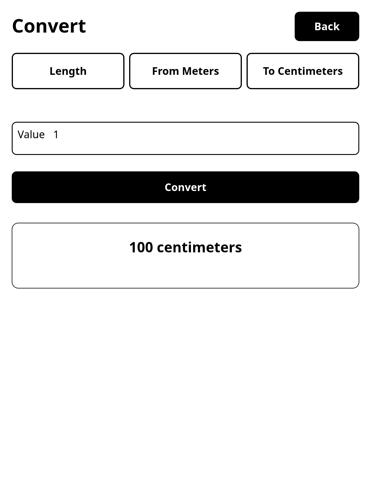
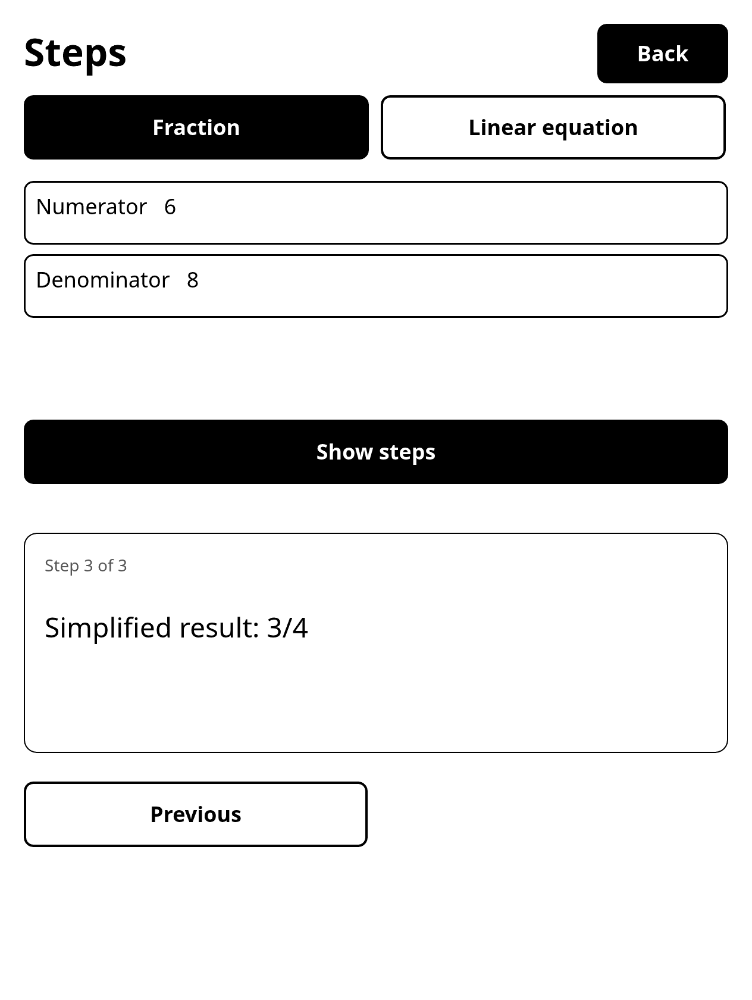
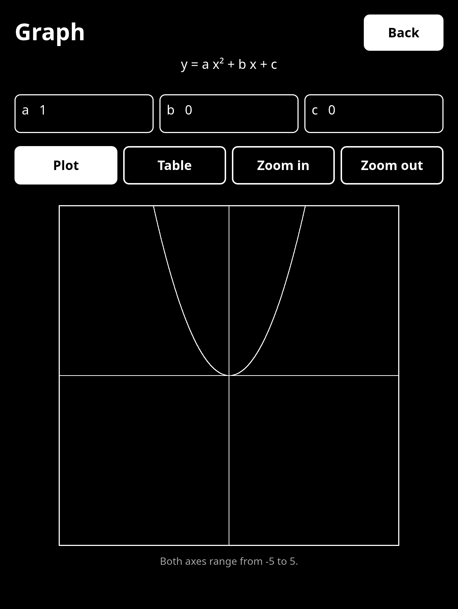
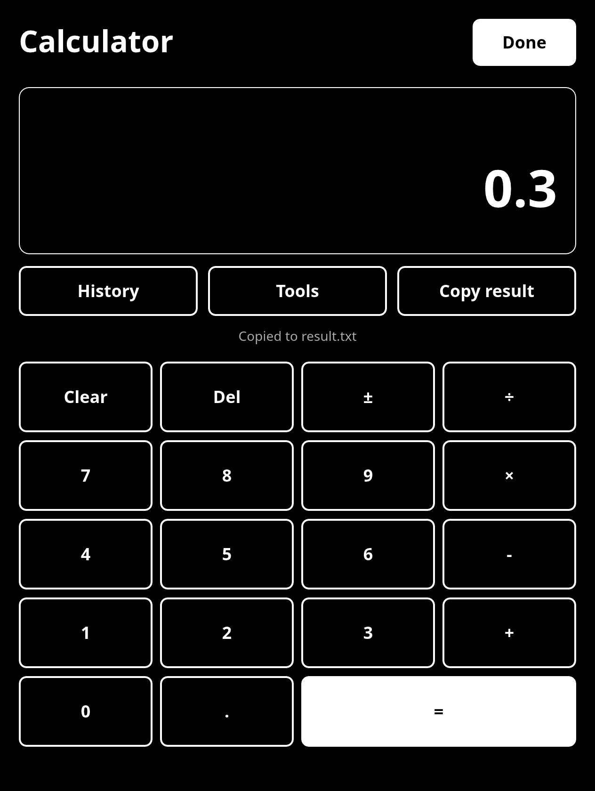

<div align="center">

# Calculator

**A decimal calculator with a large keypad for Kindle e-readers.**

[Install guide](INSTALL.md) · [Device notes](docs/device-notes.md) · [Changelog](CHANGELOG.md)

</div>

---

Do everyday arithmetic, look up earlier calculations, and save results as text for USB transfer or another app.

## Calculator tools

Open **Tools** from the keypad.

- **Convert** between common units of length, mass, volume, time, and temperature. Rounded conversions show a tilde (~).
- **Steps** explains how to simplify a fraction or solve an equation of the form `a × x + b = c`.
- **Graph** plots `y = a x² + b x + c`. Set `a` to zero for a line. Switch to **Table** for exact values at five points.

| Convert | Worked steps | Graph in dark mode |
|---|---|---|
|  |  |  |

## Screenshots

<table>
  <tr>
    <td align="center"><br><sub>The calculator keypad</sub></td>
    <td align="center"><br><sub>Calculation history</sub></td>
    <td align="center"><br><sub>Copy result in dark mode</sub></td>
  </tr>
</table>

<sub>Desktop simulation at 1264 × 1680 with sample calculations.</sub>

## Highlights

- Decimal arithmetic supports up to 18 digits and 12 decimal places. Results within those limits are exact.
- Nonterminating division is rounded and labelled. An operation other than division displays a message when the
  result requires more precision than the calculator supports.
- **History** keeps earlier calculations. **Copy result** writes `/mnt/us/calculator/result.txt`.

## Quick start

After setting up PrimitiveOS, open **Store** from Primitive Launcher. Choose **Calculator** under **Apps**,
tap **Get**, and open it from the Launcher grid. The [install guide](INSTALL.md) also covers local USB testing.

## Status

Desktop simulation and local ARMHF package checks passed on the Mac.
On an ARMHF Kindle Oasis 3 running firmware 5.18.2, Calculator showed an empty History, calculated 2 + 3 as 5,
and returned to Launcher. Orientation and result export checks are pending. [Device notes](docs/device-notes.md)

## Develop locally

Keep `doannt-kindle-tools` and `doannt-kindle-launcher` next to this checkout. The desktop command writes sample PNGs
to `build/previews`. The local `app.json` contains draft listing copy.

```sh
cargo test --offline --locked --workspace
cargo run --offline --locked -p calculator-desktop -- build/previews
```

## Licence

Copyright (C) 2026 Doan Nguyen.

App code is licensed under PolyForm Noncommercial 1.0.0. [Code license](LICENSE)

Original documentation and screenshots are licensed under Creative Commons Attribution-NonCommercial-ShareAlike 4.0
International (CC BY-NC-SA 4.0). [Documentation and image license](LICENSE-DOCS)
