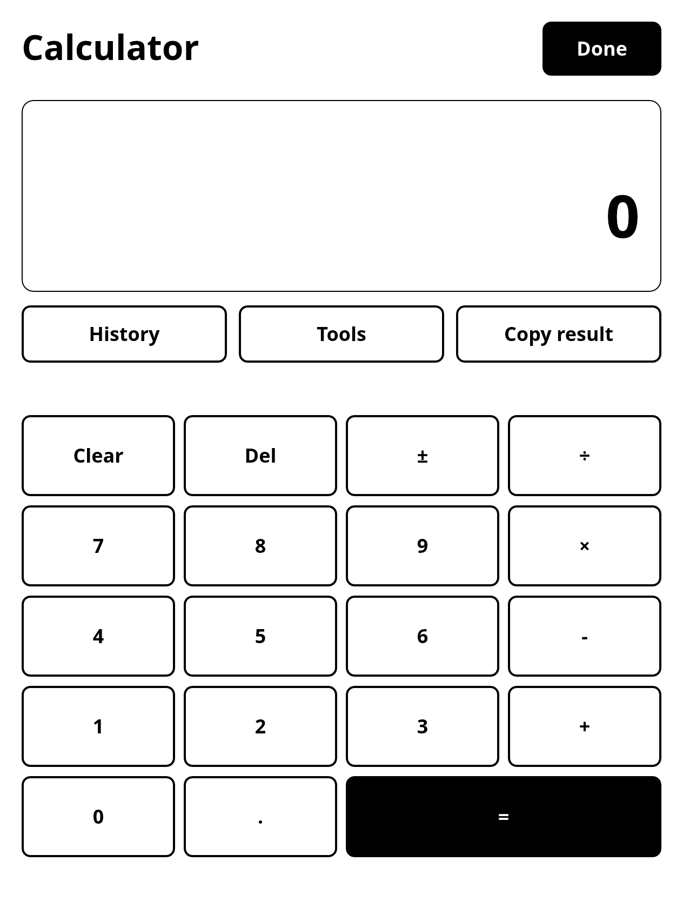

<div align="center">

# Calculator

**Decimal arithmetic and history**

[](https://github.com/PrimitiveOS/kindle-primitive-calculator/actions/workflows/ci.yml)
[](https://github.com/PrimitiveOS/kindle-primitive-calculator/releases)
[](https://github.com/PrimitiveOS/kindle-primitive-calculator/tags)
[](LICENSE)
[](https://github.com/PrimitiveOS/kindle-primitive-calculator/stargazers)
[](https://primitiveos.github.io/kindle-primitive-catalog/v1/index.json)

[**Download**](https://github.com/PrimitiveOS/kindle-primitive-calculator/releases/latest) · [**Install guide**](INSTALL.md) · [**Changelog**](CHANGELOG.md)

</div>

---

Use large keys for addition, subtraction, multiplication and division. Browse calculation history and copy the current result to a text file.

Open Tools to convert common units, see steps for simplifying fractions or solving linear equations, and plot lines or quadratics with a table of values.

## Quick start

After setting up PrimitiveOS, open **Store** from Primitive Launcher. Choose **Calculator** under **Apps**,
tap **Get**, and open it from the Launcher grid. The [install guide](INSTALL.md) also covers the standalone USB package.

## Screenshots

<table>
  <tr>
    <td align="center"><br><sub>The calculator keypad</sub></td>
    <td align="center"><br><sub>Calculation history</sub></td>
    <td align="center"><br><sub>Copy result in dark mode</sub></td>
  </tr>
</table>

<sub>Desktop simulation at 1264 × 1680 with sample calculations.</sub>

## Highlights

- Decimal arithmetic supports up to 18 digits and 12 decimal places. Results within those limits are exact.
- Nonterminating division is rounded and labelled. An operation other than division displays a message when the
  result requires more precision than the calculator supports.
- **History** keeps earlier calculations. **Copy result** writes `/mnt/us/calculator/result.txt`.

## Develop locally

Keep `doannt-kindle-tools` and `doannt-kindle-launcher` next to this checkout. The desktop command writes sample PNGs
to `build/previews`. The local `app.json` contains draft listing copy.

```sh
cargo test --offline --locked --workspace
cargo run --offline --locked -p calculator-desktop -- build/previews
```

## Status

| Device | Status |
|---|---|
| Kindle Oasis 3 (1264 × 1680, firmware 5.18.2) | Tested on hardware |

**Current version: 0.1.4.** Changes are in [CHANGELOG.md](CHANGELOG.md).

## Downloads

The badge at the top shows the number of Store downloads. It counts GitHub downloads of this app's release packages, across all versions and architectures, and is refreshed daily from the [Store catalog](https://primitiveos.github.io/kindle-primitive-catalog/v1/index.json).

## Documentation

[Install guide](INSTALL.md) · [Changelog](CHANGELOG.md) · [Device notes](docs/device-notes.md)

## Licence

Copyright (C) 2026 Doan Nguyen.

App code is licensed under PolyForm Noncommercial 1.0.0. [Code license](LICENSE)

Original documentation and screenshots are licensed under Creative Commons Attribution-NonCommercial-ShareAlike 4.0
International (CC BY-NC-SA 4.0). [Documentation and image license](LICENSE-DOCS)
